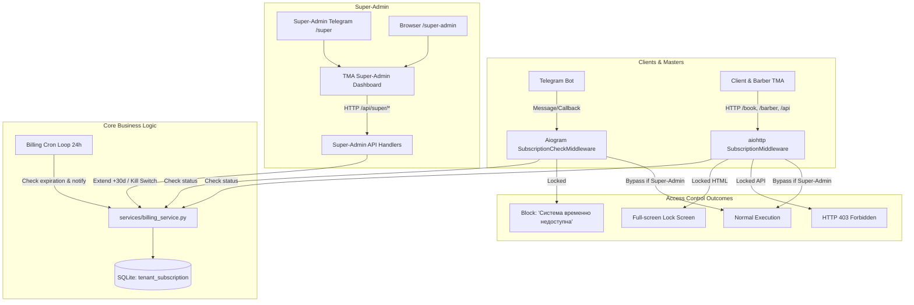

# Billing, Kill Switch, and Super-Admin Platform Implementation Plan

> **For agentic workers:** REQUIRED SUB-SKILL: Use superpowers:subagent-driven-development to implement this plan task-by-task. Steps use checkbox (`- [ ]`) syntax for tracking.

**Goal:** Implement a production-grade multi-tenant subscription registry, hard Kill Switch access control across Telegram bot and TMA Mini Apps, an automated daily notification loop, and a Super-Admin web dashboard.

**Architecture:** A centralized SQLite `tenant_subscription` table stores all salon tenants. `billing_service` calculates tenant lifecycle states (`ACTIVE`, `WARNING`, `GRACE_PERIOD`, `LOCKED`). Aiogram and aiohttp middlewares intercept all client, barber, and admin interactions when locked, presenting custom block messages and a full-screen lockout page while giving the Super-Admin complete bypass capabilities. A daily asyncio task handles expiring and expired notifications, and a dedicated `/super-admin` dashboard allows 1-click subscription extensions (+30 days) and tenant onboarding.

**Architecture Diagram:**



**Tech Stack:** Python 3.10+, aiogram 3.x, aiohttp 3.x, aiosqlite, Pydantic BaseSettings, pytest, Vanilla HTML5 + Tailwind CSS (Charcoal & Gold #c5a059).

**Spec:** [docs/superpowers/specs/2026-10-17-billing-killswitch-design.md](file:///d:/IT/B2B-SaaS/docs/superpowers/specs/2026-10-17-billing-killswitch-design.md)

## Global Constraints
- Python 3.10+ asynchronous execution using `asyncio` and `aiosqlite`.
- Preserve existing Brohouse data and business flows without disruption.
- Super-Admin must have absolute bypass across all endpoints even when tenant is locked.
- Grace period is 2 days (`grace_period_days=2`).
- No external dependencies outside standard Python libraries and existing requirements (`aiogram`, `aiohttp`, `aiosqlite`, `pydantic-settings`).
- Do NOT push to git remote (`git push`), only local commits after each task.

---

### Task 1: Database Schema & Tenant Subscription Helpers in `database.py`

**Files:**
- Modify: [database.py](file:///d:/IT/B2B-SaaS/database.py)
- Modify: [tests/test_database.py](file:///d:/IT/B2B-SaaS/tests/test_database.py)

**Interfaces:**
- Produces:
  - `get_tenant_subscription(tenant_slug: str, db_path: Optional[str] = None) -> Optional[Dict]`
  - `get_all_tenants(db_path: Optional[str] = None) -> List[Dict]`
  - `create_tenant(data: Dict, db_path: Optional[str] = None) -> int`
  - `update_tenant_subscription(tenant_id: int, updates: Dict, db_path: Optional[str] = None) -> bool`
  - `extend_tenant_subscription_30_days(tenant_id: int, db_path: Optional[str] = None) -> Optional[Dict]`
  - `toggle_tenant_active(tenant_id: int, is_active: Optional[int] = None, db_path: Optional[str] = None) -> bool`

- [ ] **Step 1: Write the failing tests in `tests/test_database.py`**

```python
@pytest.mark.asyncio
async def test_tenant_subscription_lifecycle(temp_db):
    from database import (
        get_tenant_subscription,
        get_all_tenants,
        create_tenant,
        extend_tenant_subscription_30_days,
        toggle_tenant_active,
    )
    # Default seed check
    tenant = await get_tenant_subscription("brohouse", temp_db)
    assert tenant is not None
    assert tenant["tenant_slug"] == "brohouse"
    assert tenant["is_active"] == 1
    assert tenant["grace_period_days"] == 2

    # Extend 30 days
    old_exp = tenant["expires_at"]
    updated = await extend_tenant_subscription_30_days(tenant["id"], temp_db)
    assert updated is not None
    assert updated["expires_at"] > old_exp

    # Toggle active
    ok = await toggle_tenant_active(tenant["id"], is_active=0, db_path=temp_db)
    assert ok is True
    t2 = await get_tenant_subscription("brohouse", temp_db)
    assert t2["is_active"] == 0

    # Create new tenant
    new_id = await create_tenant({
        "tenant_slug": "topgun",
        "name": "TopGun Barbershop",
        "admin_chat_id": 999999,
        "contact_phone": "+998 90 123-45-67",
        "days": 14,
    }, temp_db)
    assert new_id > 0
    all_tenants = await get_all_tenants(temp_db)
    assert len(all_tenants) >= 2
```

- [ ] **Step 2: Run test to verify it fails**

Run: `.\.venv\Scripts\python.exe -m pytest tests/test_database.py -k test_tenant_subscription_lifecycle`
Expected: FAIL with `ImportError: cannot import name 'get_tenant_subscription' from 'database'`

- [ ] **Step 3: Implement database schema and helper functions in `database.py`**

Add table `tenant_subscription`:
```sql
CREATE TABLE IF NOT EXISTS tenant_subscription (
    id INTEGER PRIMARY KEY AUTOINCREMENT,
    tenant_slug TEXT UNIQUE NOT NULL,
    name TEXT NOT NULL,
    is_active INTEGER DEFAULT 1,
    expires_at TIMESTAMP NOT NULL,
    grace_period_days INTEGER DEFAULT 2,
    admin_chat_id INTEGER,
    contact_phone TEXT,
    contact_name TEXT,
    last_notification_stage TEXT DEFAULT 'none',
    created_at TIMESTAMP DEFAULT CURRENT_TIMESTAMP,
    updated_at TIMESTAMP DEFAULT CURRENT_TIMESTAMP
);
```
Add default seed for `brohouse` if empty in `init_db()`.
Implement CRUD methods: `get_tenant_subscription`, `get_all_tenants`, `create_tenant`, `update_tenant_subscription`, `extend_tenant_subscription_30_days`, `toggle_tenant_active`.

- [ ] **Step 4: Run tests to verify they pass**

Run: `.\.venv\Scripts\python.exe -m pytest tests/test_database.py`
Expected: PASS (all tests green)

- [ ] **Step 5: Commit changes locally**

```powershell
git add database.py tests/test_database.py
git commit -m "feat(db): add tenant_subscription table and CRUD helper functions"
```

---

### Task 2: Billing & Kill Switch Calculation Service in `services/billing_service.py`

**Files:**
- Create: [services/billing_service.py](file:///d:/IT/B2B-SaaS/services/billing_service.py)
- Create: [tests/test_billing_service.py](file:///d:/IT/B2B-SaaS/tests/test_billing_service.py)

**Interfaces:**
- Consumes: `database.py` tenant functions, `services/schedule_service.py:get_now_tashkent`
- Produces:
  - `SubscriptionStatus` (Enum: `ACTIVE`, `WARNING`, `GRACE_PERIOD`, `LOCKED`)
  - `calculate_subscription_status(subscription: Dict, now: Optional[datetime] = None) -> Tuple[SubscriptionStatus, Dict]`
  - `is_subscription_locked(subscription: Dict, now: Optional[datetime] = None) -> bool`
  - `check_tenant_access(tenant_slug: str, db_path: Optional[str] = None) -> Tuple[bool, SubscriptionStatus, Dict]`
  - `run_billing_notifier(bot: Bot, check_interval_seconds: int = 86400)`

- [ ] **Step 1: Write unit tests in `tests/test_billing_service.py`**

```python
import pytest
from datetime import datetime, timedelta
from services.billing_service import (
    SubscriptionStatus,
    calculate_subscription_status,
    is_subscription_locked,
)

def test_subscription_status_active():
    now = datetime(2026, 10, 17, 12, 0)
    sub = {
        "is_active": 1,
        "expires_at": (now + timedelta(days=10)).strftime("%Y-%m-%d %H:%M:%S"),
        "grace_period_days": 2,
    }
    status, info = calculate_subscription_status(sub, now=now)
    assert status == SubscriptionStatus.ACTIVE
    assert is_subscription_locked(sub, now=now) is False

def test_subscription_status_warning():
    now = datetime(2026, 10, 17, 12, 0)
    sub = {
        "is_active": 1,
        "expires_at": (now + timedelta(days=2)).strftime("%Y-%m-%d %H:%M:%S"),
        "grace_period_days": 2,
    }
    status, info = calculate_subscription_status(sub, now=now)
    assert status == SubscriptionStatus.WARNING
    assert is_subscription_locked(sub, now=now) is False

def test_subscription_status_grace_period():
    now = datetime(2026, 10, 17, 12, 0)
    sub = {
        "is_active": 1,
        "expires_at": (now - timedelta(hours=10)).strftime("%Y-%m-%d %H:%M:%S"),
        "grace_period_days": 2,
    }
    status, info = calculate_subscription_status(sub, now=now)
    assert status == SubscriptionStatus.GRACE_PERIOD
    assert is_subscription_locked(sub, now=now) is False

def test_subscription_status_locked_after_grace():
    now = datetime(2026, 10, 17, 12, 0)
    sub = {
        "is_active": 1,
        "expires_at": (now - timedelta(days=3)).strftime("%Y-%m-%d %H:%M:%S"),
        "grace_period_days": 2,
    }
    status, info = calculate_subscription_status(sub, now=now)
    assert status == SubscriptionStatus.LOCKED
    assert is_subscription_locked(sub, now=now) is True

def test_subscription_status_manual_kill_switch():
    now = datetime(2026, 10, 17, 12, 0)
    sub = {
        "is_active": 0,  # manually switched off
        "expires_at": (now + timedelta(days=30)).strftime("%Y-%m-%d %H:%M:%S"),
        "grace_period_days": 2,
    }
    status, info = calculate_subscription_status(sub, now=now)
    assert status == SubscriptionStatus.LOCKED
    assert is_subscription_locked(sub, now=now) is True
```

- [ ] **Step 2: Run test to verify it fails**

Run: `.\.venv\Scripts\python.exe -m pytest tests/test_billing_service.py`
Expected: FAIL with `ModuleNotFoundError: No module named 'services.billing_service'`

- [ ] **Step 3: Implement `services/billing_service.py`**

Write the enum, parser, calculation methods, helper `check_tenant_access(tenant_slug, db_path)`, and `run_billing_notifier(bot)`.

- [ ] **Step 4: Run tests to verify they pass**

Run: `.\.venv\Scripts\python.exe -m pytest tests/test_billing_service.py`
Expected: PASS

- [ ] **Step 5: Commit changes locally**

```powershell
git add services/billing_service.py tests/test_billing_service.py
git commit -m "feat(billing): implement billing calculations and subscription status lifecycle"
```

---

### Task 3: Aiogram 3 Middleware & Telegram Bot Kill Switch Integration

**Files:**
- Create: [bot/middlewares.py](file:///d:/IT/B2B-SaaS/bot/middlewares.py)
- Modify: [bot/handlers.py](file:///d:/IT/B2B-SaaS/bot/handlers.py)
- Modify: [main.py](file:///d:/IT/B2B-SaaS/main.py)
- Modify: [config.py](file:///d:/IT/B2B-SaaS/config.py)
- Modify: [tests/test_handlers.py](file:///d:/IT/B2B-SaaS/tests/test_handlers.py)

**Interfaces:**
- Consumes: `services.billing_service.check_tenant_access`, `config.settings.SUPER_ADMIN_CHAT_ID`, `config.settings.TENANT_SLUG`
- Produces: `SubscriptionCheckMiddleware` registered on `router.message` and `router.callback_query`

- [ ] **Step 1: Add config fields in `config.py`**

```python
TENANT_SLUG: str = "brohouse"
SUPER_ADMIN_CHAT_ID: Optional[int] = None
SUPER_ADMIN_PASSWORD: str = "superadminbrohouse2026"
```

- [ ] **Step 2: Implement `bot/middlewares.py`**

```python
from aiogram import BaseMiddleware
from aiogram.types import Message, CallbackQuery
from config import settings
from services.billing_service import check_tenant_access

class SubscriptionCheckMiddleware(BaseMiddleware):
    async def __call__(self, handler, event, data):
        user_id = event.from_user.id if event.from_user else None
        
        # Super-Admin bypass
        if settings.SUPER_ADMIN_CHAT_ID and user_id == settings.SUPER_ADMIN_CHAT_ID:
            return await handler(event, data)
            
        is_locked, status, info = await check_tenant_access(settings.TENANT_SLUG)
        if not is_locked:
            return await handler(event, data)
            
        # If locked:
        if isinstance(event, Message):
            if settings.ADMIN_CHAT_ID and user_id == settings.ADMIN_CHAT_ID:
                await event.answer("❌ Доступ к управлению заблокирован. Срок действия подписки истек. Пожалуйста, оплатите подписку.")
            else:
                await event.answer("Система онлайн-бронирования временно недоступна. Пожалуйста, свяжитесь с салоном напрямую.")
            return
        elif isinstance(event, CallbackQuery):
            await event.answer("Система онлайн-бронирования временно недоступна.", show_alert=True)
            return
```

- [ ] **Step 3: Register middleware in `main.py` and add `/super` command in `bot/handlers.py`**

Connect `SubscriptionCheckMiddleware` in `main.py`:
```python
router.message.middleware(SubscriptionCheckMiddleware())
router.callback_query.middleware(SubscriptionCheckMiddleware())
```
Add `/super` command handler in `bot/handlers.py` that sends an inline button opening `{WEBAPP_URL}/super-admin` for `SUPER_ADMIN_CHAT_ID`.

- [ ] **Step 4: Write automated tests in `tests/test_handlers.py`**

Test that when `is_active=0` or expired, client messages are blocked with the specified message, and super-admin messages pass through.

- [ ] **Step 5: Run tests to verify**

Run: `.\.venv\Scripts\python.exe -m pytest tests/test_handlers.py`
Expected: PASS

- [ ] **Step 6: Commit changes locally**

```powershell
git add config.py bot/middlewares.py bot/handlers.py main.py tests/test_handlers.py
git commit -m "feat(bot): add subscription check middleware and super-admin command"
```

---

### Task 4: Aiohttp Middleware, 403 API Response & Full-Screen Lockout Page

**Files:**
- Modify: [web_app.py](file:///d:/IT/B2B-SaaS/web_app.py)
- Modify: [tests/test_web_app.py](file:///d:/IT/B2B-SaaS/tests/test_web_app.py)

**Interfaces:**
- Produces: `subscription_middleware` intercepting all web requests in `create_web_app`

- [ ] **Step 1: Write test for web_app subscription lockout in `tests/test_web_app.py`**

Test that:
- When tenant is locked, `GET /api/services` returns HTTP 403 `{"error": "subscription_expired", ...}`.
- When tenant is locked, `GET /book` returns HTTP 403 with HTML lockout page containing `"Доступ приостановлен"`.
- Requests with header `X-Super-Admin-Token` bypass the lockout.

- [ ] **Step 2: Implement HTML Lockout page generator & middleware in `web_app.py`**

Create `render_lockout_page(tenant_info: Dict) -> str`:
A responsive HTML page with:
- Charcoal background `#121212` and gold accent `#c5a059`.
- Glowing lock icon `🔒`.
- Heading: **Доступ приостановлен**.
- Message: **Срок действия лицензии салона истек. Пожалуйста, оплатите подписку для возобновления работы системы.**
- Call button: `tel:{contact_phone}`.
- SaaS support contact button.

Implement `@web.middleware async def subscription_middleware(request, handler)`:
- Bypass for `/static/*`, `/super-admin*`, `/api/super/*`.
- Bypass if request contains valid super-admin token (from header `X-Super-Admin-Token`, query `?token=...`, or cookie).
- Otherwise check `check_tenant_access(settings.TENANT_SLUG)`.
- If locked:
  - If URL starts with `/api/`: return `web.json_response({"error": "subscription_expired", "message": "Доступ приостановлен. Оплатите подписку."}, status=403)`
  - Otherwise return `web.Response(text=render_lockout_page(info), content_type="text/html", status=403)`.

- [ ] **Step 3: Run tests to verify**

Run: `.\.venv\Scripts\python.exe -m pytest tests/test_web_app.py`
Expected: PASS

- [ ] **Step 4: Commit changes locally**

```powershell
git add web_app.py tests/test_web_app.py
git commit -m "feat(webapp): add subscription middleware, 403 API handling, and lock screen"
```

---

### Task 5: Super-Admin Dashboard (`webapp/super_admin.html`) & Super API Endpoints

**Files:**
- Create: [webapp/super_admin.html](file:///d:/IT/B2B-SaaS/webapp/super_admin.html)
- Modify: [web_app.py](file:///d:/IT/B2B-SaaS/web_app.py)
- Modify: [tests/test_web_app.py](file:///d:/IT/B2B-SaaS/tests/test_web_app.py)

**Interfaces:**
- Produces:
  - `GET /super-admin`
  - `POST /api/super/auth`
  - `GET /api/super/tenants`
  - `POST /api/super/tenants`
  - `POST /api/super/tenants/{id}/extend-30`
  - `POST /api/super/tenants/{id}/toggle-active`

- [ ] **Step 1: Write tests for Super-Admin API in `tests/test_web_app.py`**

Test:
- `POST /api/super/auth` with valid password returns `{"ok": True, "token": "..."}`.
- `GET /api/super/tenants` returns list of tenants with subscription statuses.
- `POST /api/super/tenants/{id}/extend-30` adds 30 days.
- `POST /api/super/tenants/{id}/toggle-active` flips `is_active`.

- [ ] **Step 2: Implement Super-Admin backend endpoints in `web_app.py`**

Implement token validation helper, session generation, and all `/api/super/*` handlers.

- [ ] **Step 3: Create `webapp/super_admin.html`**

Build a state-of-the-art Super-Admin interface:
- Modern Charcoal & Gold aesthetic (`#c5a059`, dark cards, glassmorphism, glowing badges).
- Password login overlay for browser access.
- Auto-login if opened with valid token or `initData`.
- KPI Header Cards:
  - 🏢 Всего заведений
  - 🟢 Активные подписки
  - 🟡 В льготном периоде (Grace)
  - 🔴 Заблокировано (Kill Switch)
- Tenants Table:
  - Salon Name, Slug, Phone, Admin Chat ID.
  - Expiration Date & Remaining Days counter badge (e.g. `28 дн.`, `Grace: 1 дн.`, `Заблокировано`).
  - Actions:
    - **⚡ +30 дней** button (optimistic instant update).
    - **🔒 Kill Switch** button (toggle freeze / unfreeze).
    - **🔗 Войти как салон** (preview `/book` or `/admin` with bypass).
- **➕ Добавить салон** modal dialog.

- [ ] **Step 4: Run tests to verify**

Run: `.\.venv\Scripts\python.exe -m pytest tests/`
Expected: PASS (all tests pass)

- [ ] **Step 5: Commit changes locally**

```powershell
git add webapp/super_admin.html web_app.py tests/test_web_app.py
git commit -m "feat(superadmin): add super-admin management dashboard and API endpoints"
```

---

### Task 6: Background Notifier Loop & Final Verification

**Files:**
- Modify: [main.py](file:///d:/IT/B2B-SaaS/main.py)
- Modify: [walkthrough.md](file:///d:/IT/B2B-SaaS/walkthrough.md)

- [ ] **Step 1: Connect `run_billing_notifier` in `main.py`**

In `main()`:
```python
notifier_task = asyncio.create_task(run_billing_notifier(bot))
```
In `finally:` block:
```python
notifier_task.cancel()
```

- [ ] **Step 2: Run complete pytest suite**

Run: `.\.venv\Scripts\python.exe -m pytest tests/ -v`
Expected: PASS (all tests green)

- [ ] **Step 3: Commit changes locally**

```powershell
git add main.py walkthrough.md
git commit -m "feat: complete billing, kill switch, and super-admin integration"
```

---

## Verification Plan

### Automated Tests
```powershell
.\.venv\Scripts\python.exe -m pytest tests/ -v
```

### Manual Verification
1. **Normal State**:
   - Open TMA `/book` — booking opens normally.
   - Run `/price` in bot — responds with services.
2. **Grace Period State**:
   - Set `expires_at` to yesterday with `grace_period_days=2`.
   - In TMA `/admin`: yellow warning banner displays countdown.
   - Online booking continues to work.
3. **Locked State (Kill Switch)**:
   - Toggle Kill Switch in Super-Admin or set `is_active=0`.
   - As client in bot: sends *"Система онлайн-бронирования временно недоступна..."*.
   - Open TMA `/book` or `/barber`: full-screen lock screen displayed with 403 status.
   - In Super-Admin dashboard `/super-admin`: click **⚡ +30 дней** — instantly unlocks!
