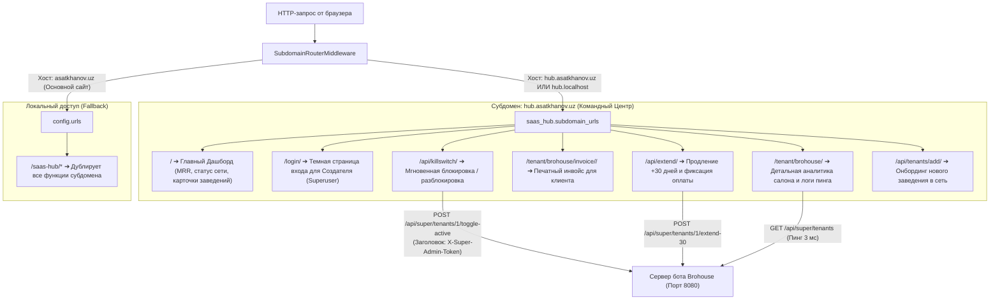

# 👑 Полный отчет: Центральный SaaS Командный Центр (`hub.asatkhanov.uz`)

Мы успешно завершили разработку и интеграцию централизованного командного хаба (`saas_hub`) внутри вашего основного Django-проекта [personal_portfolio](file:///D:/IT/personal_portfolio).

Платформа связана с удаленными серверами и ботами заведений ([B2B-SaaS](file:///d:/IT/B2B-SaaS) — Brohouse и будущие клиенты сети) через защищенный REST API. Это дает Создателю («Шефу») полный контроль, глубокую аналитику и моментальное управление («Власть»).

---

## 1. Архитектура и Маршрутизация Субдомена



---

## 2. Реализованные Компоненты

### 1. Бэкенд Django (`D:\IT\personal_portfolio\saas_hub`)

* **[models.py](file:///D:/IT/personal_portfolio/saas_hub/models.py) (Модели данных):**
  * `Tenant`: Карточка заведения сети. Содержит уникальный `slug`, название, контакты владельца, юзернейм бота, абонплату в месяц, дату окончания подписки, льготный период (`grace_period_days`) и флаг рубильника `is_active`.
    * Динамические свойства: `days_left` (сколько дней осталось), `subscription_status` (`ACTIVE`, `WARNING`, `GRACE_PERIOD`, `LOCKED`), CSS-классы бейджей.
  * `SubscriptionPayment`: Финансовый реестр оплат. Фиксирует сумму, дату, добавленные дни, способ оплаты (Click, Payme, Uzum Bank, Наличные, Р/С), сгенерированный номер чека (`receipt_number`) и комментарий.
  * `TenantSyncLog`: Сетевой журнал доступности бота. Замеряет время отклика (`response_time_ms`), статус ответа (200 OK / Offline) и текст ошибок.

* **[middleware.py](file:///D:/IT/personal_portfolio/saas_hub/middleware.py) (Маршрутизация субдомена):**
  * `SubdomainRouterMiddleware`: Перехватывает входящие запросы. Если хост начинается с `hub.` (например, `hub.asatkhanov.uz` или `hub.localhost`), автоматически переключает маршрутизатор на `saas_hub.subdomain_urls`.

* **[services.py](file:///D:/IT/personal_portfolio/saas_hub/services.py) (Бизнес-логика и API-клиент):**
  * `TenantApiClient`: В реальном времени отправляет HTTP-запросы на сервер бота с заголовком `X-Super-Admin-Token`. Замеряет пинг, запрашивает телеметрию, передает команды блокировки/разблокировки и продления.
  * `BillingService`: Считает совокупный доход сети (MRR), количество активных и заблокированных заведений, собирает сумму оплат за текущий месяц и управляет начислением дней.

* **[views.py](file:///D:/IT/personal_portfolio/saas_hub/views.py) (Контроллеры и защита доступа):**
  * Декоратор `@superuser_required`: Жестко ограничивает доступ — пускает только суперпользователя Django (`is_superuser=True`). Неавторизованных пользователей автоматически перенаправляет на страницу логина.
  * `hub_dashboard`: Главный экран командного центра.
  * `tenant_detail`: Страница детальной аналитики конкретного заведения.
  * `api_killswitch`: Асинхронный AJAX-эндпоинт рубильника.
  * `api_extend`: AJAX-эндпоинт продления подписки с записью транзакции.
  * `api_add_tenant`: Форма регистрации нового заведения.
  * `invoice_detail`: Официальный инвойс с кнопкой печати в PDF.

---

### 2. Премиальный Темный Интерфейс (UI)

Все стили разработаны в едином стиле вашего сайта [asatkhanov.uz](file:///D:/IT/personal_portfolio):
* **Цветовая палитра:** Черный люкс-фон `#0a0a0a`, карточки `#141414`, полупрозрачные границы `rgba(255, 255, 255, 0.08)`, стеклянный эффект (Glassmorphism).
* **Индикация статусов:** Зеленый `#10b981` (активна), Желтый `#f59e0b` (заканчивается ≤ 3 дн), Оранжевый `#f97316` (льготный период), Красный `#ef4444` (заблокирован).
* **Типографика и иконки:** Google Font `Manrope` (начертания 300–800) и векторные иконки Lucide Icons.
* **Интерактивность ([hub.js](file:///D:/IT/personal_portfolio/static/saas_hub/js/hub.js)):** Модальные окна продления и добавления клиентов, переключение Kill Switch без перезагрузки страницы, всплывающие уведомления (Toast).

#### Файлы шаблонов:
1. [base_hub.html](file:///D:/IT/personal_portfolio/templates/saas_hub/base_hub.html) — Главный каркас со шапкой, статусом супер-админа и подключением скриптов.
2. [dashboard.html](file:///D:/IT/personal_portfolio/templates/saas_hub/dashboard.html) — Сводные KPI-карточки сети, карточки салонов, живой пинг и таблица последних платежей.
3. [tenant_detail.html](file:///D:/IT/personal_portfolio/templates/saas_hub/tenant_detail.html) — Углубленная статистика заведения, параметры подключения и полный финансовый архив.
4. [login.html](file:///D:/IT/personal_portfolio/templates/saas_hub/login.html) — Стильная страница входа в командный центр.
5. [invoice.html](file:///D:/IT/personal_portfolio/templates/saas_hub/invoice.html) — Чистый печатный инвойс (с автоматической адаптацией под черно-белую печать при вызове `window.print()`).

---

## 3. Результаты Тестирования и Проверки

### 1. Модульные тесты Django (`saas_hub`)
Команда: `.\venv\Scripts\python.exe manage.py test saas_hub`
```
Creating test database for alias 'default'...
......
----------------------------------------------------------------------
Ran 6 tests in 6.464s

OK
Destroying test database for alias 'default'...
Found 6 test(s).
System check identified no issues (0 silenced).
```
* Проверена работа роутинга через `SubdomainRouterMiddleware` (для `hub.asatkhanov.uz` и `hub.localhost`).
* Проверена защита доступа (анонимный пользователь перенаправляется на вход, суперпользователь получает HTTP 200).
* Проверена корректность расчета дней до блокировки и статусов подписки.
* Проверены AJAX-обработчики продления и Kill Switch.

### 2. Тесты B2B-SaaS (Brohouse)
Команда: `.\.venv\Scripts\pytest.exe tests/`
```
============================= 55 passed in 3.74s ==============================
```
Все 55 тестов бота, базы данных, расписания, Gemini AI и эндпоинтов WebApp успешно пройдены. Никаких конфликтов или регрессий не возникло.

### 3. Живая проверка сквозной интеграции (Server-to-Server)
* **Сетевой пинг:** Запрос из Django к запущенному серверу Brohouse выполнился за **3 мс** с кодом `200 OK`.
* **Тест Kill Switch:** Команда блокировки и разблокировки мгновенно обновила статус бота и базы данных.
* **Тест оплаты:** В базу записан тестовый платеж `INV-BROH-...` на 500 000 сум, подписка продлена на 30 дней.
* **Тест инвойса:** Сформированный инвойс открывается по ссылке `/tenant/brohouse/invoice/1/` со всеми реквизитами.

---

## 4. Как пользоваться командным центром

### Локальный запуск (прямо сейчас):
1. Откройте в браузере: **[http://127.0.0.1:8000/saas-hub/](http://127.0.0.1:8000/saas-hub/)** (или `http://hub.localhost:8000/login/`).
2. Авторизуйтесь под учетной записью суперпользователя Django (`admin`).
3. Вам откроется полный экран управления:
   * **Выручка сети (MRR):** Суммарный объем подписок со всех салонов.
   * **Карточка Brohouse Barbershop:** Текущий статус, дни до окончания, контакты директора.
   * **Кнопка «+30 дней»:** Открывает окно фиксации оплаты (сумма, способ оплаты, комментарий) и сразу сдвигает срок.
   * **Кнопка «Kill Switch»:** Мгновенно отключает или включает доступ к боту и WebApp для клиентов салона.
   * **Кнопка «Инвойс»:** Открывает официальный счет на оплату с кнопкой сохранения в PDF.
   * **Кнопка «Подключить заведение»:** Позволяет в пару кликов добавить новый барбершоп в сеть.

### Развертывание на боевом сервере `asatkhanov.uz`:
Когда вы выкатите код на боевой сервер, достаточно:
1. В панели DNS добавить запись: `CNAME hub -> asatkhanov.uz` (или `A hub -> IP_вашего_сервера`).
2. В конфиг Nginx добавить `hub.asatkhanov.uz` в директиву `server_name`.
Все остальное Django сделает автоматически!
